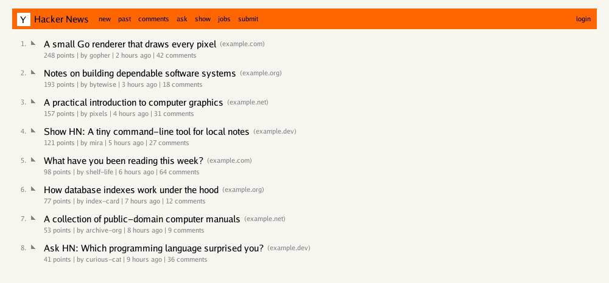
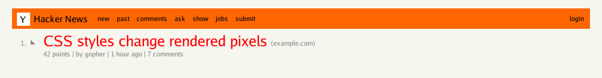

# gobrowser



Example generated from the bundled HTML fixture.

The second example demonstrates embedded CSS changing story-title color and size:



## Run

Render the live Hacker News homepage:

```sh
go run . -out hackernews.png
```

Render a saved HTML page:

```sh
go run . -input testdata/hackernews.html -out hackernews.png
```

Options:

- `-url`: page URL to fetch (default: `https://news.ycombinator.com/`)
- `-input`: saved HTML file; when set, it is used instead of `-url`
- `-out`: PNG output path (default: `hackernews.png`)
- `-width`: image width in pixels, from 640 to 4096 (default: `1000`)
- `-stories`: maximum number of stories, from 1 to 30 (default: `30`)

## Supported page structure

This renderer targets Hacker News story tables: ranked `.athing` rows with `.titleline` titles and optional `.sitebit` domains, followed by `.subtext` metadata (`.score`, `.hnuser`, `.age`, and comments links). It draws a fixed Hacker News-inspired layout with an orange navigation bar, ranked titles, domains, and metadata using an embedded Go font. Embedded `<style>` rules, inline styles, and linked stylesheets can set story-title `color` and `font-size`; selectors support tag, ID, and class components with descendant and child combinators. Color accepts common names, hex, and integer `rgb()` values. Font sizes accept `px`, `pt`, `em`, `rem`, and `%`, bounded to 1–64 pixels; story rows expand to fit larger titles and keep metadata below them.

When fetching a page, the renderer loads up to 8 ordinary, same-origin HTTP(S) `rel="stylesheet"` links (including relative URLs and links resolved against the document’s `<base>` URL). Stylesheet redirects stay on the page’s origin; each stylesheet is limited to 1 MiB, all linked CSS to 4 MiB, and stylesheet fetching to 20 seconds. Linked CSS is not fetched for saved local HTML. Other resources, general page layout, images, and interactive browser behavior are not implemented.

CSS support is intentionally limited to story-title declarations. See [issue #4](https://github.com/lukehoban/gobrowser/issues/4) for the initial rendering slice and [issue #5](https://github.com/lukehoban/gobrowser/issues/5) for focused CSS support.
